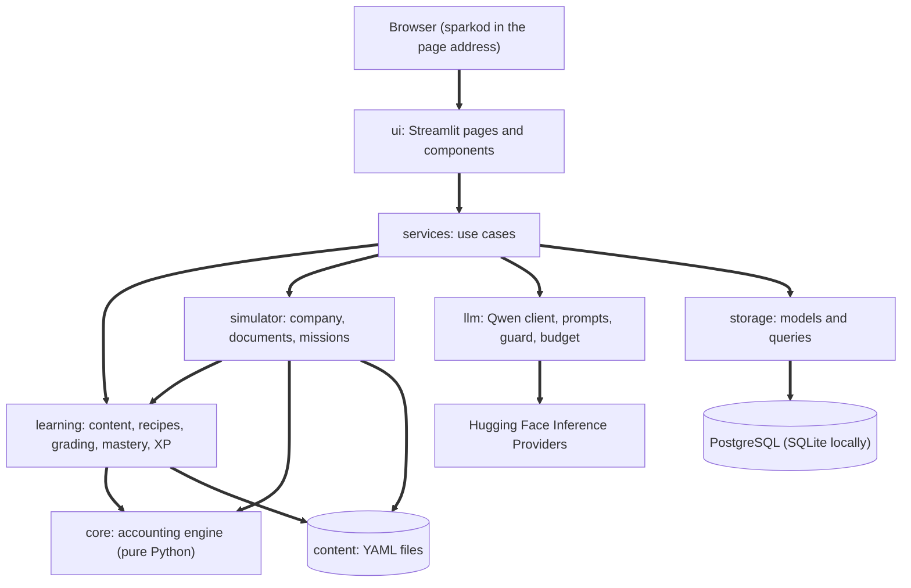
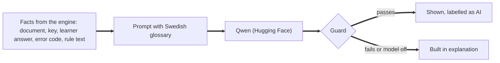
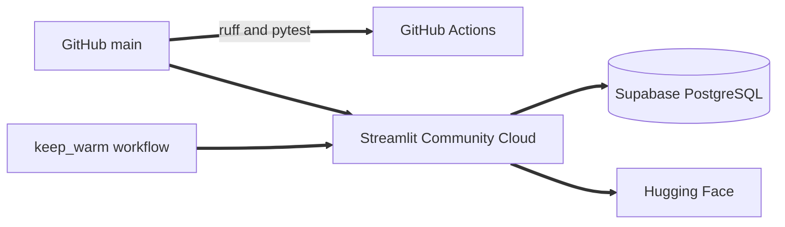

# ARCHITECTURE: Redovisningsakademin

**Version:** 0.3 (one week scope)
**Date:** 10 November 2026
**Read together with:** `docs/PRD.md`, `docs/TASKS.md`, `CLAUDE.md`.

Each section gives the decision and the reason.

## 1. System overview

One Streamlit app, one PostgreSQL database, content as YAML files, a pure Python accounting engine, and an optional language model behind a guard.



## 2. Principles

1. **The engine decides.** Every amount, balance, report and answer key comes from `core`. One place to be right.
2. **Dependencies point inward.** `ui` calls `services`. `services` combines `learning`, `simulator`, `llm`, `storage` and `core`. `core` imports nothing from the project and nothing from Streamlit. Reason: the engine can be reused behind another interface, and an employer can read it in isolation.
3. **Content is data.** Lessons, exercises, rules, rates, the kontoplan and the scenario are YAML files. A changed momssats is a data edit.
4. **The journal is append only.** Posted verifikationer are never changed; corrections are new verifikationer that point to the old one.
5. **Exact money.** Integer öre everywhere. No floats in `core`.
6. **The model never decides.** The language model receives finished facts and writes text. It does not grade, calculate, choose accounts or cite rules on its own.
7. **Simple first.** No migration framework, no background jobs, no client side code. What a week can carry.

## 3. Technology stack

* Python 3.12 and Streamlit 1.50 or later (`st.navigation`, `st.data_editor`, `st.fragment`).
* SQLAlchemy 2. PostgreSQL in production (Supabase free tier) through the psycopg 3 driver (`psycopg[binary]`, address prefix `postgresql+psycopg://`), SQLite locally. Tables are created with `create_all` at start; a migration tool is added only when the schema first has to change after launch.
* Pydantic 2 and PyYAML for content.
* Plotly for the few charts.
* `huggingface_hub` for the model, Qwen3 as default (Qwen3-14B, because Qwen3-8B is served only by a provider the owner's token has not enabled), model name and provider set in secrets (same setup as the owner's ekonomistyrning app).
* pytest and ruff. Nothing more.

## 4. Directory structure

```
redovisningsakademin/
    app.py                      entry point: page config, sparkod, navigation
    CLAUDE.md
    CHANGELOG.md
    README.md
    pyproject.toml
    requirements.txt            "-e ." for Streamlit Community Cloud
    .streamlit/
        config.toml
        secrets.toml.example
    docs/
        PRD.md
        ARCHITECTURE.md
        TASKS.md
        KALLKONTROLL.md         log of checked sources (laws, rates, accounts)
        LIMITATIONS.md
    src/
        ra/
            core/
                money.py
                formatting.py           format_ore: Swedish display of amounts
                chart.py
                voucher.py
                ledger.py
                vat.py
                payroll.py
                depreciation.py
                reconciliation.py
                reports.py
            learning/
                schemas.py
                loader.py
                recipes.py
                grading.py
                feedback.py
                documents.py            underlag from a recipe's figures and its template
                hitta_felet.py
                avstamning.py
                mastery.py
                gamification.py
                exams.py
            simulator/
                scenario.py
                documents.py
                evaluate.py
            llm/
                client.py
                clean.py                cleaning step: stiff phrases, markup, dashes, number format
                prompts.py
                guard.py
                budget.py
                scenario_text.py
            storage/
                models.py
                db.py
                queries.py
            services/
                learner.py
                practice.py
                lessons.py              module list with progress, one lesson and its worked example
                reference.py            Regelbibliotek and Kontoplan with search and filters
                simulator.py
                profile.py
                tutor.py
                scenarios.py            Nytt scenario: a new instance with a story
                ai.py                   the one way to the model: cache, budget, cleaning, guard
                formatting.py           passes core formatting to ui
            paths.py                content folder and local database: environment, then working directory
            ui/
                pages/
                components/
                navigation.py           grouped st.navigation and sidebar links
                theme.py
                i18n.py                 t() and the language switch
                texts_en.py             English interface texts
    static/
        fonts/                  self-hosted Inter and IBM Plex Mono, registered in config.toml
    content/
        kontoplan.yaml
        momssatser.yaml
        parametrar.yaml         dated values, for example the arbetsgivaravgift rate
        ordlista.yaml
        kompetenser.yaml
        moduler.yaml            module titles and descriptions; lessons refer to a module by id
        dokumentmallar.yaml     how each recipe's figures are shown as an underlag
        moduler/
            m1/ ... m6/
        regler/
        prov/
        en/                     English versions of lessons, feedback, rules, exams
        scenario_nordvik/
        feedback.yaml
        marken.yaml
    tests/
        test_core.py
        test_recipes.py
        test_guard.py
        test_content.py
        test_smoke.py
    scripts/
        validate_content.py
    .github/
        workflows/
            ci.yml
            keep_warm.yml
```

File and identifier names are ASCII (`moduler`, `marken`, `ovar`). Text shown to learners always uses å, ä and ö.

## 5. Database

**Why PostgreSQL in production:** Streamlit Community Cloud does not keep local files between restarts, so a SQLite file would lose all progress. SQLite stays for local work because it needs no setup.

**What is stored:** only learner state. Content stays in files and is referred to by identifier.

Seven tables.

* **learner:** `id` (UUID), `code_hash` (SHA 256 of the sparkod, unique), `created_at`, `last_seen_at`, `streak_current`, `streak_longest`, `last_active_on`, `settings` (JSON).
* **attempt:** `id`, `learner_id`, `item_id`, `skill_id`, `context` (lektion, ovning, repetition, simulator, utmaning), `difficulty`, `seed`, `is_correct`, `attempt_no`, `hints_used`, `error_codes` (JSON), `xp`, `created_at`. Index on (`learner_id`, `skill_id`, `created_at`).
* **skill_state:** key (`learner_id`, `skill_id`); `state`, `total`, `recent` (JSON list of the latest 8 results), `kontering_passed`, `repetitions_ok`, `due_on`.
* **sim_voucher:** `id`, `learner_id`, `sim_seed`, `series`, `number`, `entry_date`, `text`, `document_id`, `corrects_id` (nullable), `created_at`.
* **sim_voucher_line:** `id`, `voucher_id`, `account_no`, `debit_ore`, `credit_ore`. Check: exactly one of the two is greater than zero.

* **exam_result:** `id`, `learner_id`, `exam_id`, `seed`, `score`, `passed`, `created_at`.
* **llm_usage:** `day` (key), `calls`. Model calls per day for the whole app, with no learner identifier (D6.1).

XP total is the sum of `attempt.xp`; badges are derived from attempts and vouchers when the page loads. Reason: fewer tables and nothing that can drift out of step.

Limits: 500 verifikationer per learner and simulator run; learners inactive for 18 months are removed by a script.

## 6. Identity without accounts

1. First visit: the app creates a random sparkod (128 bits), stores its hash with a new learner row and writes the code into the page address with `st.query_params`.
2. Return visit: the code in the address is hashed and the learner is loaded.

Implementation: the address parameter is `kod` (22 URL safe characters from `secrets.token_urlsafe(16)`); a missing, malformed or unknown code creates a new learner. `services/learner.py` offers `get_or_create`, `reset_simulator` and `delete_all`. `storage/db.py` reads `DATABASE_URL` from the environment or Streamlit secrets, rewrites a plain `postgresql://` address to the psycopg driver, turns off prepared statements for the Supabase transaction pooler, and falls back to `ra_local.db` (SQLite). Streamlit can drop query parameters on a page switch, so `get_or_create` writes the code kept in session state back into the address instead of creating a new learner; a different valid code in the address loads that learner.
3. Settings shows the code, a copy button, "Byt enhet" (the same link works anywhere), "Återställ simulatorn" and "Radera min progression".

Reason for the address and not browser storage: Streamlit has no built in access to browser storage, and proving a custom component across browsers would cost a day of the week. The address method is the one already used and tested in the owner's ekonomistyrning app. Cost: a shared link shares the progress. Accepted because no personal data exists, and stated on the settings page.

## 7. Accounting engine (`core`)

**Model.** `Money` (integer öre, `percent` with round half up to whole öre, halves away from zero; `Money.parse` reads "1 250,50"; a float raises `MoneyTypeError`), `Account` (number, name, class, kind, normal side, report line), `VoucherLine` (account, side, amount), `Voucher` (series, number, date, text, lines, corrects), `VoucherKey` (series, number) used by `corrects`. All immutable. `validate` returns a list of `Issue` with an `IssueCode` and, for line issues, the account.

**Functions other layers use.**
* `validate(chart, voucher)`: unbalanced, fewer than two lines, unknown account, zero amount, missing text.
* `open_journal(chart, opening)` and `post(journal, voucher)`: the `Journal` holds the kontoplan, the ingående balanser (signed, debet positive, must balance) and the posted verifikationer. `post` validates, numbers per series, checks that a rättelse points at an existing verifikation and returns a new journal; it raises `PostingError` with the issues.
* `ledger(journal)`: ingående balans, debet, kredit and utgående balans per account.
* `trial_balance(journal)`: råbalans with summa debet and summa kredit of the utgående balanser.
* `reports.income_statement(chart, journal)` (period movements; rörelseresultat, resultat efter finansiella poster, årets resultat) and `reports.balance_sheet(chart, journal)` (utgående balanser; summa tillgångar, summa eget kapital och skulder, with the period's result in Årets resultat) through the report line of each account. Line names follow K2 punkt 4.4 and ÅRL bilaga 1; an unknown report line raises `ReportError`.
* `vat.load_vat_table(path)` returns a `VatTable` with `rate_for(code, on_date)`, `add(net, code, on_date)` and `split(gross, code, on_date)` (moms = brutto x sats / (100 + sats)); `vat.report(chart, journal)` gives utgående moms per rate, ingående moms and the net, through each account's moms role; `vat.settlement(chart, journal, on_date)` returns the unposted momsomföring to the momsredovisningskonto. Both `report` and `settlement` take optional `period_from` and `period_to` dates (inclusive) and count only verifikationer in the period, so a journal can hold several months; `settlement` also takes `refund_account` (1650 Momsfordran) for a net to get back, as at a bokslut. `vat.eu_purchase_lines` and `vat.eu_sale_lines` give the kontering for trade with businesses in other EU countries; the report shows the EU bases (rutor 20, 21, 35, 39) and the calculated utgående moms (ruta 30) on their own lines, and ingående moms includes the calculated part (ruta 48). Reverse charge for trade with other EU countries: a purchase books calculated utgående and ingående moms that cancel out, a sale carries no moms, and both appear on their own lines in the report.
* `reconciliation.compare(bank_lines, ledger_lines, bank_opening=, ledger_opening=)`: lines match on equal amount with dates at most three days apart (closest date first); returns matched pairs, bank lines without a ledger entry, ledger entries without a bank line, and the difference between the statement's closing balance and the ledger balance.
* `payroll.calculate(gross, tax_withheld, on_date, params)` returning nettolön and arbetsgivaravgifter, and `payroll.vouchers(employees, salary_on, payment_on, params, accounts)` returning the löneverifikation, the arbetsgivaravgifter verifikation and the inbetalning to the skattekonto. Dated values come from `parameters.load_parameters(path)` (`content/parametrar.yaml`).
* `depreciation.monthly(cost, months)` (each month rounded down to whole öre, the last month takes the remainder) and `depreciation.voucher(amount, on_date)`.

**Rules that always hold.**
1. Every posted verifikation balances to the öre.
2. Total debet equals total kredit in the råbalans.
3. Tillgångar equal eget kapital plus skulder plus the period's result.
4. Posting never changes earlier verifikationer.

**Rates and thresholds** are read by transaction date from `momssatser.yaml` and `parametrar.yaml`, each with source and checked date. Reason: the temporary 6 percent on livsmedel in 2026 and 2027 shows that rates in code would be wrong for part of the time.

**Kontoplan.** `chart.load_chart(path)` returns a read only `Chart` (a mapping from number to `Account`, with `by_moms_role`). It rejects duplicate numbers, a first digit that differs from the class, and a kind that does not fit the class (1 tillgång; 2 eget kapital or skuld; 3 intäkt; 4 to 7 kostnad; 8 intäkt or kostnad). Report lines start with `rr.` or `br.`. `kontoplan.yaml` holds the BAS subset: number, name exactly as in the official BAS publication, class, kind, normal side, report line and moms role. The Kontoplan page credits BAS as the source.

## 8. Learning engine

**Content.** A lesson file holds title, skills, the four fields (`vad`, `varfor`, `hur`, `nar`), rule references, a worked example and a list of exercises. An exercise names its type, skill, difficulty, a parameter range and a **recipe**.

```yaml
id: m3.l2.e1
typ: kontering
kompetens: B2
niva: grund
parametrar: {netto_ore: {min: 200000, max: 2500000, steg: 10000}, momskod: [SE25]}
dokument: leverantorsfaktura
recept: leverantorsfaktura
regel: bfl.5.7
tips: "Börja med fakturans totalbelopp på leverantörsskulden. Dela sedan upp i kostnad och moms."
```

Lessons may add `forenkling`, a sentence on what the lesson simplifies, shown in a box headed "Förenklat exempel". Module titles live in `content/moduler.yaml`; a lesson that names an unknown module is an error.

**Loading and validation.** `learning/schemas.py` holds frozen Pydantic models that reject unknown keys. `learning/loader.py` parses every file and collects all errors (`read_content`), then checks references and builds a read only `ContentLibrary` (`resolve`): unknown skills or rules, duplicate ids, and a published lesson that cites a rule with status utkast are errors. Entries with status utkast are hidden unless `include_drafts` is set. With English chosen, a file with the same relative path under `content/en` replaces the Swedish one. `scripts/validate_content.py` adds the checks that need the engine: every exercise's recipe is run on five seeds and its key validated against the kontoplan, document templates and `svar` figures must exist, and Swedish files pass the spelling guard (ASCII misspellings and dashes used as punctuation).

**Recipes.** A recipe is a function that takes sampled parameters and calls `core` to produce the document figures and the accepted verifikation or verifikationer. Reason: the key always agrees with the engine, every attempt has new numbers, and a key can only be wrong where code is tested. About 24 recipes cover the week, including four for trade with other EU countries.

`recipes.py` registers each recipe with its default parameter ranges. `generate(ctx, name, seed, overrides)` samples a date in the exercise year and the parameters from the seed, then runs the recipe; `run` does the same with fixed parameters (worked examples). A recipe returns a `RecipeResult`: the document figures, the accepted `Voucher` and `alternatives`, a mapping from a key account to other accounts accepted in its place (for example 6110 or 5460 for kontorsmateriel). `RecipeContext` holds the kontoplan, momssatser and parametrar. `content/dokumentmallar.yaml` has one template per recipe that names which figures the underlag shows.

**Grading.** Normalise the answer (merge equal rows, ignore order), validate with `core`, compare with the accepted solutions, classify the error.

Error codes: `OBALANS`, `FEL_SIDA`, `FEL_KONTO`, `FEL_KONTOKLASS`, `MOMS_SAKNAS`, `MOMS_FEL_SATS`, `MOMS_PA_BRUTTO`, `MOMS_FEL_RIKTNING`, `FEL_BELOPP`, `RAD_SAKNAS`, `EXTRA_RAD`.

Classification pairs the answer with the key after merging rows and reading accepted alternative accounts as the key's account: exact rows are removed, then the same account on the other side (`FEL_SIDA`), the same account with another amount (`FEL_BELOPP`, or for a moms row `MOMS_PA_BRUTTO` when the amount is the rate on the gross and `MOMS_FEL_SATS` when it is another rate on the net), then moms rows with moms rows (`MOMS_FEL_RIKTNING` across utgående and ingående, `MOMS_FEL_SATS` across rates), then other rows on the same side (`FEL_KONTOKLASS` when the kind differs, else `FEL_KONTO`). Leftovers are `MOMS_SAKNAS`, `RAD_SAKNAS` or `EXTRA_RAD`; an unbalanced answer adds `OBALANS`. Codes are ordered by how much they explain: `FEL_SIDA`, `MOMS_PA_BRUTTO`, `MOMS_FEL_RIKTNING`, `MOMS_FEL_SATS`, `MOMS_SAKNAS`, `FEL_KONTOKLASS`, `FEL_KONTO`, `OBALANS`, `FEL_BELOPP`, `RAD_SAKNAS`, `EXTRA_RAD`.

**Feedback.** The five parts are built from the error code (texts in `feedback.yaml`), the exercise's rule and its tip. The first code words parts 1 and 2; further codes are named in one sentence. Without a matching code the general text in `feedback.yaml` is used, so the feedback is still complete. Part 3 holds the key verifikation and one note per accepted alternative account, for right and wrong answers alike. The validator checks that `feedback.yaml` covers exactly the grader's codes.

**Hitta felet and Avstämning.** `hitta_felet.plant(chart, voucher, seed)` books a recipe's key with one error chosen by seed: debet and kredit swapped on every row, a wrong momskonto, or two adjacent kronor digits swapped on the largest row with the largest row on the other side adjusted so the verifikation still balances. `grade_correction` posts the learner's rättelse after the wrong verifikation (with `corrects` pointing at it) and compares the huvudbok with one where only the correct verifikation is booked; any correction with the same effect is accepted. `avstamning.generate(ctx, seed)` builds a month of payments for 1930 from `inbetalning_kund` and `utbetalning_leverantor`, adds a bank fee on the kontoutdrag that is missing in the huvudbok and books one payment with two digits swapped. The lines the learner must mark are the kontoutdrag lines `reconciliation.compare` leaves unmatched; the bookings are graded on their effect per account, and the remaining difference is computed with `compare`.

**Mastery, repetition, XP.** Pure functions that take the skill state and one result and return the new state, due date and XP, following PRD sections 6 and 9. `mastery.update` counts a success as a correct answer without hints, keeps the latest eight results, and recomputes the state each time, so a skill can also fall back. A repetition is a success on or after the due date; due dates are 1, 3 and 7 days, and a miss sets the next due date to one day and the repetition count to zero. `gamification.xp_for` gives full XP on a correct first attempt without hints, half with hints, and none on a wrong answer or a later attempt on the same instance, because the feedback shows the solution. Levels use XP thresholds chosen by the app (250, 750, 1 500, 3 000), with the role gates from PRD section 9.

**Practice service.** `services/practice.py` is the only entry point for exercises. `next_exercise` picks a published övning for the skill and difficulty, preferring ones the learner has not tried, and returns an `ExerciseView` with the underlag (`learning/documents.py` lays out recipe figures by template; a figure to compute is hidden). `submit` regenerates the instance from exercise id and seed, parses the grid rows (amounts are typed text, parsed with `Money.parse`; problems such as an unreadable amount are returned without grading), grades, builds the feedback and, in one transaction, stores the attempt, updates `skill_state` (first attempt only) and the svit. View models with formatted amounts and dates are in `services/views.py`. Content with status utkast is visible only when the environment variable `RA_SHOW_DRAFTS` is `1`.

**Exercise interface.** `ui/components/voucher.py` is the shared verifikation component: `voucher_grid` (st.data_editor; the account column offers every account as "1930 Företagskonto" so the learner searches by number or name; amounts are typed as text and right aligned; running totals and a balance indicator with colour, sign and sentence come from `services.practice.totals`) and `voucher_table_html` for read only verifikationer. `document_viewer.py` renders an underlag from the `DocumentView`, `feedback_panel.py` the five parts in fixed order, `statement.py` the kontoutdrag with a checkbox per line, and `hint.py` the tip button. All HTML is built from escaped app data. The Övningar page (`ui/pages/ovningar.py`) keeps the current exercise id and seed in session state and runs the exercise inside `st.fragment`; it calls `services.practice` only.

**Lessons.** `services/lessons.py` builds the module list (lessons in id order, with a done flag) and one lesson. A lesson is done when every Kontroll item has at least one correct attempt (`queries.correct_items`). The worked example is run by its recipe with fixed parameters; its effect on the reports comes from `core.reports` on a journal that holds only that verifikation, so the lesson shows the changed lines of the resultaträkning and the balansräkning and both totals. `ui/pages/lektioner.py` shows the four steps as tabs: Förklara (the four fields, the simplification box and rule links to the Regelbibliotek with `?regel=<id>`), Visa, Gör (one exercise at a time, with tips) and Kontroll (no tips, attempts stored with context `kontroll`). `ui/components/exercise.py` is the shared exercise body (instruction, underlag, answer widget, tip, buttons, feedback) used by Övningar, lessons and Repetition. "Ny uppgift" runs an `on_new` click callback instead of a fragment rerun, and `forget_instance` clears the tip state and result of only the instance being replaced. Modules, lessons and rules are listed in natural id order (`loader.natural_key`: m2 before m10, bfl.5.7 before bfl.10.1).

**Repetition and reference pages.** `practice.due_skills` returns skills whose due date has come and that have published övningar; the Repetition page runs them as a session of up to ten exercises (context `repetition`) and ends with a summary of right and wrong per skill and the next due date. `services/reference.py` serves the rule entries (search over every word, filter by type of norm) and the kontoplan grouped by kontoklass, and reads the source block of `kontoplan.yaml` through `core.chart.load_chart_source` for the BAS credit on the Kontoplan page.

**Exams.** `exams.py` draws items by seed from the exam definition, grades everything at submission and returns score and pass or fail. No hints and no AI controls are available before submission.

**Languages.** Swedish is the source. Interface strings pass through `t()`, which returns the text in `texts_en.py` when English is chosen. Content has optional English files with the same identifiers under `content/en`; the loader falls back to Swedish when a file is missing. The kontoplan and the documents are never translated.

## 9. Simulator

The scenario folder contains the company profile, opening balances as an opening verifikation, customers, suppliers, employees, the month's calendar of about 22 events, the month's kontoutdrag with two planted differences, and document templates. Each event names a recipe, so the simulator and the exercises share keys. For that reason `simulator` imports `learning.recipes` as well as `core`; it does not import `services`, `storage` or `ui`.

**Scenario (`simulator/scenario.py`, `content/scenario_nordvik`).** Six files: `foretag.yaml` (profile, redovisningsval, the inventarie in use), `parter.yaml` (three Swedish customers and one in Finland, three Swedish suppliers and one in Denmark, the shop for card purchases and the bank), `anstallda.yaml` (three employees with fixed monthly salaries), `ingaende_balanser.yaml` (the opening verifikation and the open invoices), `kalender.yaml` (23 events in January 2026) and `kontoutdrag.yaml`. An event's parameter is fixed, sampled from the run's seed (`{min, max, steg}` or a list), or taken from an earlier event's figure (`{fran, figur}`), so a payment always equals its invoice. Three month recipes are the scenario's own because their key depends on the whole company: `lon_manad` and `arbetsgivaravgifter_manad` (all employees through `payroll.vouchers`) and `momsomforing_manad` (`vat.settlement` over the month). `load_scenario` checks the schemas, references, date order, the opening verifikation against the kontoplan, 1510 and 2440 against the open invoices, 1220 and 1229 against the inventarie and its depreciation so far, the kontoutdrag's opening balance against 1930, and that every organisation number and momsregistreringsnummer fails its check digit, so none can belong to a real company. `realise(scenario, ctx, seed)` returns the reference month: each event's parameters and recipe result posted in order after the opening balances, and the kontoutdrag rows with amounts from each event's movement on 1930 plus the two planted rows (a customer payment and a bank fee that have no document). `check_scenario` runs both on five seeds and checks that every event that moves 1930 is on the kontoutdrag; the content validator calls it.

**Documents and evaluation (`simulator/documents.py`, `simulator/evaluate.py`).** Each event's document is laid out by a template (the scenario's own `dokumentmallar.yaml` for the three month recipes, else the recipe's template in `content/dokumentmallar.yaml`) with the recipe figures for the run's seed; the counterparty and the text come from the event (`{bolag}`, `{motpart}`, `{fakturanummer}`, `{forfallodag}`, `{avser}` and recipe figures are filled in), and `dolda` hides figures as "Att beräkna" (the momsomföring). The current day is the date of the earliest event without a verifikation, and every document dated on or before it is in the Inkorg, so the month is worked in order. The key is the event's recipe result, except the momsomföring, whose key `vat.settlement` computes from the learner's own journal. A first booking is graded as an exercise answer; after a rättelse the original and all its rättelser are graded together on their net effect per account. An event is graded as a kontering exercise (`evaluate.as_exercise`, item id `sim.<event>`, difficulty medel), so XP, mastery and the five part feedback are shared with practice through `practice.record_graded`.

**Service (`services/simulator.py`).** The run's seed is kept in `learner.settings["sim_seed"]`; `start` creates it. `inbox` lists the arrived documents with status ny, bokförd or rättad and whether the booking is right; `document` renders one. `submit` refuses what core rejects (obalans, missing text, a date outside the month, the 500 verifikationer limit) with the totals for an obalans, refuses a document that has not arrived or is already booked, and otherwise stores the verifikation with the next number in series A, records the attempt and skill state and returns the feedback, in one transaction. `correct` stores a new verifikation with `corrects_id` pointing at the old one and grades the document again. `reports` recomputes verifikationslista (with the ingående balanser as IB and links in both directions), huvudbok, råbalans, resultaträkning, balansräkning and the momsrapport by fält from the stored lines. `reset` gives the learner a new seed; the old run's verifikationer stay stored and unchanged but are no longer shown. No code updates or deletes a stored verifikation; only "Radera min progression" (`learner.delete_all`) and `learner.reset_simulator` remove a learner's rows. `scripts/simulate_month.py` books the reference month through the service in a temporary database and checks the result.

**Page (`ui/pages/simulator.py`).** Bokföringssimulatorn is one page in the Praktik group. It opens with the company and its redovisningsval, then the Inkorg: the simulator's date, the documents that have arrived as a table with status (ny, bokförd, rättad, and right or wrong), and a choice of document. The chosen document is shown beside the verifikation grid (series A, date limited to the month, text) at laptop width. A refused booking explains why; for an obalans it states summa debet, summa kredit and the difference and that nothing was booked. A booked document shows its verifikationer with the links in both directions ("Rättar verifikation A 1", "Rättas av verifikation A 2"), the feedback panel, "Nästa dokument" and the Rättelse form, which books a new verifikation against a chosen earlier one. The workspace is an `st.fragment`; a booking reruns the whole page so the Inkorg and its statuses update. A view switch shows Rapporter instead (`ui/components/sim_reports.py`): tabs for verifikationslista (with IB and rättelse links), huvudbok per konto (ingående balans, entries, summa rörelser, utgående balans), råbalans, resultaträkning (rörelseresultat, resultat efter finansiella poster, periodens resultat), balansräkning and the momsrapport by fält 10 to 12, 20, 21, 30, 35, 39, 48 and 49. The råbalans and the balansräkning carry an indicator with colour, sign and sentence. Every report is recomputed from the stored verifikationer on each run, so it changes as soon as something is booked.

**Uppdrag, bankavstämning and month end.** `content/scenario_nordvik/uppdrag.yaml` lists six missions in order under Löpande bokföring, Bankavstämning and Månadens avslut (löner with arbetsgivaravgifter, förutbetald kostnad, avskrivning, momsavstämning with omföring); every event belongs to exactly one mission, which the loader checks. A document mission is klart when all its documents are booked and graded right after any rättelser, pågår when one of them is in the Inkorg, and väntar otherwise; `missions` also names the next document to open. The bankavstämning is ready when every document that moves 1930 is booked. `reconciliation` shows the kontoutdrag beside the bank account's entries with both balances; `reconcile` stores the learner's booking (document id `avstamning`) and grades it like the Avstämning exercise: the marked lines must be the kontoutdrag lines `reconciliation.compare` leaves unmatched against the bank account without the avstämning bookings, and all avstämning bookings together must have the effect of the two planted rows (a booking that covers only some of them is graded RAD_SAKNAS). The mission is complete when the ledger balance of 1930 equals the kontoutdrag's closing balance. `month_summary` gives the resultaträkning, the balansräkning, the share of documents right at the first booking per skill, and the badge "Månaden avslutad" once every mission is klart. The page opens on Uppdrag, whose buttons open the next document or the bankavstämning; "Börja om med nya siffror" calls `reset`.

Posting a verifikation: the page sends the rows to `services.simulator.submit`; the service validates with `core`, evaluates against the event's recipe, and in one database transaction stores the verifikation, the attempt and the skill state; it returns feedback and fresh report figures. Reports are recomputed from the stored lines each time; a month is a few hundred lines, so this is fast and always correct.

Bankavstämning needs no table of its own: the mission is complete when the ledger balance of the bank account equals the closing balance of the kontoutdrag.

## 10. AI layer (`llm`)



**Three uses.**
* `tutor.explain`: rephrases the already decided feedback in at most 120 words.
* `tutor.answer`: answers a learner question about the current exercise, from the supplied facts only; declines other topics.
* `scenario_text.generate`: returns JSON with company type, counterparty name, goods or service description and one situation sentence for a chosen recipe. The JSON is validated with Pydantic and its text is placed in the document template. Amounts and accounts are filled in by the recipe afterwards.

**Client (`client.py`).** `HF_TOKEN`, `LLM_MODEL` and `LLM_PROVIDER` are read from the environment, then Streamlit secrets. `chat` sends one request through `huggingface_hub.InferenceClient` with a 30 second timeout and temperature 0.2, switches Qwen3's thinking off with `/no_think` and removes any `<think>` block from the answer; every failure is raised as `ModelUnavailable`. Identical prompts (same model, provider, system prompt, user prompt and token limit) are answered from a process wide cache of 256 entries.

**Guard (`guard.py`).** An answer is shown only if all hold: every amount in it exists among the supplied facts; every four digit account number exists among the supplied facts; no paragraph sign or law name appears that was not supplied; length within the limit; the text is Swedish (contains no long runs of English and no Chinese characters); the model's thinking block is removed. Otherwise the built in explanation is used and the failure is logged. "Supplied" means written in the facts text the model received: `read_claims` reads the facts and the answer with the same rules. A number before "kr", "kronor" or "SEK", or with a decimal comma or space grouped thousands, is an amount, compared in öre; a number before "%" or "procent" is a rate; another four digit number is an account number or a year; any other number of three or more digits must also be in the facts. Law names (bokföringslagen, mervärdesskattelagen and the others the content cites), their abbreviations, K2 and K3, chapters and paragraphs must appear in the facts. A run of English is three English function words within eight words; in English mode only the Chinese, Japanese and Korean check applies.

**Cleaning (`clean.py`).** Before the guard: Markdown headings and LaTeX are removed, known stiff phrases ("Sammanfattningsvis", "Det är viktigt att notera att") are dropped and the sentence gets its capital back, dashes used as punctuation become commas, a subtraction is written "minus", and English number formatting (1,234.56) becomes Swedish (1 234,56).

**Budget (`budget.py`).** 30 calls per session and a daily cap for the whole app, counted in the database. Identical prompts are cached. The daily cap is `LLM_DAILY_CAP` (default 200). The session count is kept in session state, the daily count in `llm_usage`; a call is counted before it is sent, and a cached answer costs nothing.

**Service (`services/ai.py`).** `available()` is true when a token is set; the interface shows AI controls only then. `ask(task, facts, max_words, language)` builds the system prompt with the glossary, asks the cache, checks and counts the budget, calls the model, cleans the answer and runs the guard. It returns the text, or no text with a status (off, session cap, daily cap, failed call, stopped by the guard) so the page shows its built in explanation. Failures are logged without the learner's text.

**Tutor (`services/tutor.py`, `ui/components/tutor.py`).** Both controls appear under the feedback of a graded practice exercise (Övningar, the Gör and Kontroll steps of a lesson, Repetition) and only when `available()` is true. `facts` writes the exercise as the learner saw it (type, instruction, underlag, the booked verifikation in Hitta felet, the kontoutdrag and huvudbok lines in Avstämning), the learner's answer (`SubmitResult.answer`, built by `practice.answer_lines`), the grade with its error codes, Vad som blev fel, Varför, the correct treatment with its verifikation and notes, the tip and the rule entry. `explain` (wrong answers only) asks for three to five short sentences, at most 120 words, that compare the answer with the key and use only the feedback's reasons. `answer` sends the learner's question (one line, at most 300 characters, not part of the facts the guard checks against) and asks for an answer from the facts only; for an off topic question the model writes the marker `[UTANFÖR]`, and the page shows its own polite refusal, so a refusal is always correct Swedish. In English mode the model is asked to answer in English; the facts stay in Swedish. Model text is shown escaped in a box labelled "Förklaring skapad av AI. Facit och belopp kommer från appens bokföringsmotor."; with no text the page says why (no safe answer, session cap, daily cap) and the built in feedback stands alone. The state belongs to the graded result, so grading again clears it.

**Nytt scenario (`llm/scenario_text.py`, `services/scenarios.py`).** Ten domestic recipes with an outside counterparty (supplier and customer invoices and payments, receipts, purchases of inventarier) support a story; internal documents, Skatteverket, the bank, the landlord and EU trade keep their text. `generate(recipe, category, seed, call)` asks for JSON with bransch, motpart, beskrivning and situation; the prompt names the role, the recipe's own description as the category, a starting letter drawn by seed (so each instance has its own prompt and is not served from the cache) and one example answer, at temperature 0.7. `ScenarioText` (Pydantic, frozen, no extra keys) caps every length and refuses digits, "kr", "%", "konto", dashes, markup, Chinese characters and English, a name without AB, HB or KB, a name containing one of about 90 well known companies and authorities, a situation that is not one sentence starting with "Företaget", and furniture, machines or computers under kontorsmateriel or förbrukningsmaterial. Anything refused, and no answer at all, gives a built in story from paired name and bransch lists, without a message. `services.scenarios.new_instance` draws a new seed for the same exercise, generates the story and keeps it in session state; `practice` applies it to the underlag: the counterparty with its bransch, the situation before the template's text, and the description after the recipe's own on the amount row ("Kontorsmateriel: papper och pärmar"), because the recipe's description decides the account. The amounts, the accounts and the key are the recipe's. The Övningar page shows "Nytt scenario" beside "Ny uppgift" when the model is configured and the exercise supports a story, and a caption under the underlag says the story is written by AI. `ai.complete` gives the raw text for such structured requests: no cleaning and no guard, so the caller validates everything itself.

**Swedish quality.** The system prompt includes the terms from `ordlista.yaml` and asks for short sentences. A cleaning step fixes known stiff phrases. Low temperature. Lesson text, rules and keys are never model written.

**Privacy.** Prompts contain exercise facts and the learner's question, no identifier. The privacy page says that questions to the tutor are processed by Hugging Face.

**Reuse.** `client.py`, the cleaning step and the budget are adapted from `utils/llm.py`, `utils/humanizer.py` and `utils/llm_budget.py` in the owner's ekonomistyrning repository.

## 11. Testing (kept small on purpose)

Tests exist where an error would teach wrong accounting, and nowhere else.

* `test_core.py`: money rounding, validation of an unbalanced verifikation, moms at each rate and on both sides of a dated change, one purchase from and one sale to another EU country, one payroll case, one depreciation case, one bankavstämning case, and one small month of about 15 verifikationer whose råbalans and reports were calculated by hand.
* `test_recipes.py`: each recipe once, with hand calculated figures written in the test.
* `test_guard.py`: the guard rejects an answer with an amount that was not supplied and accepts one that uses only supplied amounts (asked for by D6.1).
* `test_content.py`: runs `scripts/validate_content.py` (schemas, references, the four lesson fields, every recipe executed on a few sampled parameters, Swedish spelling guard).
* `test_smoke.py`: the app starts and every page loads in both languages, and every interface string has an English text.

No tests for interface details, queries, services or the model's wording. No coverage target.

## 12. Security and privacy

No personal data, no trackers. Secrets only in Streamlit secrets. SQL through SQLAlchemy parameters. Learner text (verifikation text, tutor questions) is length limited and shown as plain text. The sparkod is stored hashed. Model calls are capped.

## 13. Deployment



Secrets: `DATABASE_URL`, `HF_TOKEN`, `LLM_MODEL`, `LLM_PROVIDER`, `LLM_DAILY_CAP`. The repository secret `APP_URL` holds the app address for `keep_warm.yml`. A scheduled workflow requests the app during European daytime to reduce cold starts and keep the database active.

## 14. Growth path

More learners: a paid host with more memory. A richer interface: replace `ui` and keep everything else, which principle 2 makes possible. Schema changes after launch: add a migration tool at that point. Further content: new YAML files and recipes, no structural change.
