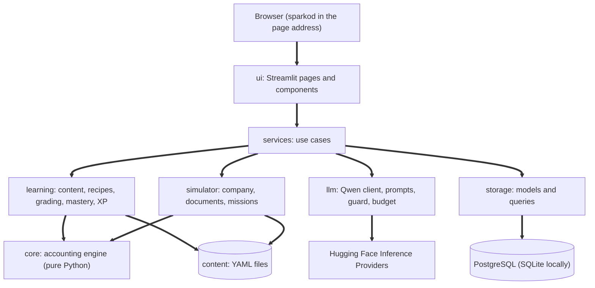
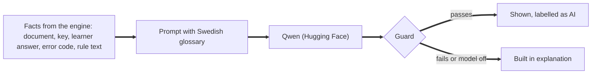
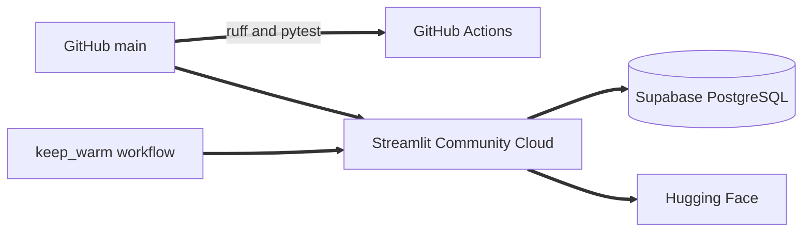

# ARCHITECTURE: Redovisningsakademin

**Version:** 0.3 (one week scope)
**Date:** 10 November 2026
**Read together with:** `docs/PRD.md`, `docs/TASKS.md`, `CLAUDE.md`.

Each section gives the decision and the reason.

## 1. System overview

One Streamlit app, one PostgreSQL database, content as YAML files, a pure Python accounting engine, and an optional language model behind a guard.



## 2. Principles

1. **The engine decides.** Every amount, balance, report and answer key comes from `core`. One place to be right.
2. **Dependencies point inward.** `ui` calls `services`. `services` combines `learning`, `simulator`, `llm`, `storage` and `core`. `core` imports nothing from the project and nothing from Streamlit. Reason: the engine can be reused behind another interface, and an employer can read it in isolation.
3. **Content is data.** Lessons, exercises, rules, rates, the kontoplan and the scenario are YAML files. A changed momssats is a data edit.
4. **The journal is append only.** Posted verifikationer are never changed; corrections are new verifikationer that point to the old one.
5. **Exact money.** Integer öre everywhere. No floats in `core`.
6. **The model never decides.** The language model receives finished facts and writes text. It does not grade, calculate, choose accounts or cite rules on its own.
7. **Simple first.** No migration framework, no background jobs, no client side code. What a week can carry.

## 3. Technology stack

* Python 3.12 and Streamlit 1.50 or later (`st.navigation`, `st.data_editor`, `st.fragment`).
* SQLAlchemy 2. PostgreSQL in production (Supabase free tier) through the psycopg 3 driver (`psycopg[binary]`, address prefix `postgresql+psycopg://`), SQLite locally. Tables are created with `create_all` at start; a migration tool is added only when the schema first has to change after launch.
* Pydantic 2 and PyYAML for content.
* Plotly for the few charts.
* `huggingface_hub` for the model, Qwen3 as default, model name and provider set in secrets (same setup as the owner's ekonomistyrning app).
* pytest and ruff. Nothing more.

## 4. Directory structure

```
redovisningsakademin/
    app.py                      entry point: page config, sparkod, navigation
    CLAUDE.md
    CHANGELOG.md
    README.md
    pyproject.toml
    requirements.txt            "-e ." for Streamlit Community Cloud
    .streamlit/
        config.toml
        secrets.toml.example
    docs/
        PRD.md
        ARCHITECTURE.md
        TASKS.md
        KALLKONTROLL.md         log of checked sources (laws, rates, accounts)
        LIMITATIONS.md
    src/
        ra/
            core/
                money.py
                formatting.py           format_ore: Swedish display of amounts
                chart.py
                voucher.py
                ledger.py
                vat.py
                payroll.py
                depreciation.py
                reconciliation.py
                reports.py
            learning/
                schemas.py
                loader.py
                recipes.py
                grading.py
                feedback.py
                mastery.py
                gamification.py
                exams.py
            simulator/
                scenario.py
                documents.py
                evaluate.py
            llm/
                client.py
                prompts.py
                guard.py
                budget.py
                scenario_text.py
            storage/
                models.py
                db.py
                queries.py
            services/
                learner.py
                practice.py
                simulator.py
                profile.py
                tutor.py
                formatting.py           passes core formatting to ui
            ui/
                pages/
                components/
                navigation.py           grouped st.navigation and sidebar links
                theme.py
                i18n.py                 t() and the language switch
                texts_en.py             English interface texts
    static/
        fonts/                  self-hosted Inter and IBM Plex Mono, registered in config.toml
    content/
        kontoplan.yaml
        momssatser.yaml
        parametrar.yaml         dated values, for example the arbetsgivaravgift rate
        ordlista.yaml
        kompetenser.yaml
        moduler/
            m1/ ... m6/
        regler/
        prov/
        en/                     English versions of lessons, feedback, rules, exams
        scenario_nordvik/
        feedback.yaml
        marken.yaml
    tests/
        test_core.py
        test_recipes.py
        test_content.py
        test_smoke.py
    scripts/
        validate_content.py
    .github/
        workflows/
            ci.yml
            keep_warm.yml
```

File and identifier names are ASCII (`moduler`, `marken`, `ovar`). Text shown to learners always uses å, ä and ö.

## 5. Database

**Why PostgreSQL in production:** Streamlit Community Cloud does not keep local files between restarts, so a SQLite file would lose all progress. SQLite stays for local work because it needs no setup.

**What is stored:** only learner state. Content stays in files and is referred to by identifier.

Six tables.

* **learner:** `id` (UUID), `code_hash` (SHA 256 of the sparkod, unique), `created_at`, `last_seen_at`, `streak_current`, `streak_longest`, `last_active_on`, `settings` (JSON).
* **attempt:** `id`, `learner_id`, `item_id`, `skill_id`, `context` (lektion, ovning, repetition, simulator, utmaning), `difficulty`, `seed`, `is_correct`, `attempt_no`, `hints_used`, `error_codes` (JSON), `xp`, `created_at`. Index on (`learner_id`, `skill_id`, `created_at`).
* **skill_state:** key (`learner_id`, `skill_id`); `state`, `total`, `recent` (JSON list of the latest 8 results), `kontering_passed`, `repetitions_ok`, `due_on`.
* **sim_voucher:** `id`, `learner_id`, `sim_seed`, `series`, `number`, `entry_date`, `text`, `document_id`, `corrects_id` (nullable), `created_at`.
* **sim_voucher_line:** `id`, `voucher_id`, `account_no`, `debit_ore`, `credit_ore`. Check: exactly one of the two is greater than zero.

* **exam_result:** `id`, `learner_id`, `exam_id`, `seed`, `score`, `passed`, `created_at`.

XP total is the sum of `attempt.xp`; badges are derived from attempts and vouchers when the page loads. Reason: fewer tables and nothing that can drift out of step.

Limits: 500 verifikationer per learner and simulator run; learners inactive for 18 months are removed by a script.

## 6. Identity without accounts

1. First visit: the app creates a random sparkod (128 bits), stores its hash with a new learner row and writes the code into the page address with `st.query_params`.
2. Return visit: the code in the address is hashed and the learner is loaded.

Implementation: the address parameter is `kod` (22 URL safe characters from `secrets.token_urlsafe(16)`); a missing, malformed or unknown code creates a new learner. `services/learner.py` offers `get_or_create`, `reset_simulator` and `delete_all`. `storage/db.py` reads `DATABASE_URL` from the environment or Streamlit secrets, rewrites a plain `postgresql://` address to the psycopg driver, turns off prepared statements for the Supabase transaction pooler, and falls back to `ra_local.db` (SQLite). Streamlit can drop query parameters on a page switch, so `get_or_create` writes the code kept in session state back into the address instead of creating a new learner; a different valid code in the address loads that learner.
3. Settings shows the code, a copy button, "Byt enhet" (the same link works anywhere), "Återställ simulatorn" and "Radera min progression".

Reason for the address and not browser storage: Streamlit has no built in access to browser storage, and proving a custom component across browsers would cost a day of the week. The address method is the one already used and tested in the owner's ekonomistyrning app. Cost: a shared link shares the progress. Accepted because no personal data exists, and stated on the settings page.

## 7. Accounting engine (`core`)

**Model.** `Money` (integer öre, `percent` with round half up to whole öre, halves away from zero; `Money.parse` reads "1 250,50"; a float raises `MoneyTypeError`), `Account` (number, name, class, kind, normal side, report line), `VoucherLine` (account, side, amount), `Voucher` (series, number, date, text, lines, corrects), `VoucherKey` (series, number) used by `corrects`. All immutable. `validate` returns a list of `Issue` with an `IssueCode` and, for line issues, the account.

**Functions other layers use.**
* `validate(chart, voucher)`: unbalanced, fewer than two lines, unknown account, zero amount, missing text.
* `post(journal, voucher)`: returns a new journal.
* `ledger(chart, journal)`: balances and movements per account.
* `trial_balance(chart, journal)`.
* `income_statement(chart, journal)` and `balance_sheet(chart, journal)` through the report line of each account.
* `vat.add(net, code, on_date)`, `vat.split(gross, code, on_date)`, `vat.report(journal)`, `vat.settlement(journal)`. Reverse charge for trade with other EU countries: a purchase books calculated utgående and ingående moms that cancel out, a sale carries no moms, and both appear on their own lines in the report.
* `reconciliation.compare(bank_lines, ledger_lines)`: matched pairs, bank lines without a ledger entry, ledger entries without a bank line, and the balance difference.
* `payroll.calculate(gross, tax, on_date)` returning nettolön and arbetsgivaravgifter, and `payroll.vouchers(...)`.
* `depreciation.monthly(cost, months)` and its verifikation.

**Rules that always hold.**
1. Every posted verifikation balances to the öre.
2. Total debet equals total kredit in the råbalans.
3. Tillgångar equal eget kapital plus skulder plus the period's result.
4. Posting never changes earlier verifikationer.

**Rates and thresholds** are read by transaction date from `momssatser.yaml` and `parametrar.yaml`, each with source and checked date. Reason: the temporary 6 percent on livsmedel in 2026 and 2027 shows that rates in code would be wrong for part of the time.

**Kontoplan.** `chart.load_chart(path)` returns a read only `Chart` (a mapping from number to `Account`, with `by_moms_role`). It rejects duplicate numbers, a first digit that differs from the class, and a kind that does not fit the class (1 tillgång; 2 eget kapital or skuld; 3 intäkt; 4 to 7 kostnad; 8 intäkt or kostnad). Report lines start with `rr.` or `br.`. `kontoplan.yaml` holds the BAS subset: number, name exactly as in the official BAS publication, class, kind, normal side, report line and moms role. The Kontoplan page credits BAS as the source.

## 8. Learning engine

**Content.** A lesson file holds title, skills, the four fields (`vad`, `varfor`, `hur`, `nar`), rule references, a worked example and a list of exercises. An exercise names its type, skill, difficulty, a parameter range and a **recipe**.

```yaml
id: m3.l2.e1
typ: kontering
kompetens: B2
niva: grund
parametrar: {netto_ore: {min: 200000, max: 2500000, steg: 10000}, momskod: [SE25]}
dokument: leverantorsfaktura
recept: leverantorsfaktura
regel: bfl.5.7
tips: "Börja med fakturans totalbelopp på leverantörsskulden. Dela sedan upp i kostnad och moms."
```

**Recipes.** A recipe is a function that takes sampled parameters and calls `core` to produce the document figures and the accepted verifikation or verifikationer. Reason: the key always agrees with the engine, every attempt has new numbers, and a key can only be wrong where code is tested. About 24 recipes cover the week, including four for trade with other EU countries.

**Grading.** Normalise the answer (merge equal rows, ignore order), validate with `core`, compare with the accepted solutions, classify the error.

Error codes: `OBALANS`, `FEL_SIDA`, `FEL_KONTO`, `FEL_KONTOKLASS`, `MOMS_SAKNAS`, `MOMS_FEL_SATS`, `MOMS_PA_BRUTTO`, `MOMS_FEL_RIKTNING`, `FEL_BELOPP`, `RAD_SAKNAS`, `EXTRA_RAD`.

**Feedback.** The five parts are built from the error code (texts in `feedback.yaml`), the exercise's rule and its tip. Without a matching code a general but complete feedback is shown.

**Mastery, repetition, XP.** Pure functions that take the skill state and one result and return the new state, due date and XP, following PRD sections 6 and 9.

**Exams.** `exams.py` draws items by seed from the exam definition, grades everything at submission and returns score and pass or fail. No hints and no AI controls are available before submission.

**Languages.** Swedish is the source. Interface strings pass through `t()`, which returns the text in `texts_en.py` when English is chosen. Content has optional English files with the same identifiers under `content/en`; the loader falls back to Swedish when a file is missing. The kontoplan and the documents are never translated.

## 9. Simulator

The scenario folder contains the company profile, opening balances as an opening verifikation, customers, suppliers, employees, the month's calendar of about 22 events, the month's kontoutdrag with two planted differences, and document templates. Each event names a recipe, so the simulator and the exercises share keys.

Posting a verifikation: the page sends the rows to `services.simulator.submit`; the service validates with `core`, evaluates against the event's recipe, and in one database transaction stores the verifikation, the attempt and the skill state; it returns feedback and fresh report figures. Reports are recomputed from the stored lines each time; a month is a few hundred lines, so this is fast and always correct.

Bankavstämning needs no table of its own: the mission is complete when the ledger balance of the bank account equals the closing balance of the kontoutdrag.

## 10. AI layer (`llm`)



**Three uses.**
* `tutor.explain`: rephrases the already decided feedback in at most 120 words.
* `tutor.answer`: answers a learner question about the current exercise, from the supplied facts only; declines other topics.
* `scenario_text.generate`: returns JSON with company type, counterparty name, goods or service description and one situation sentence for a chosen recipe. The JSON is validated with Pydantic and its text is placed in the document template. Amounts and accounts are filled in by the recipe afterwards.

**Guard (`guard.py`).** An answer is shown only if all hold: every amount in it exists among the supplied facts; every four digit account number exists among the supplied facts; no paragraph sign or law name appears that was not supplied; length within the limit; the text is Swedish (contains no long runs of English and no Chinese characters); the model's thinking block is removed. Otherwise the built in explanation is used and the failure is logged.

**Budget (`budget.py`).** 30 calls per session and a daily cap for the whole app, counted in the database. Identical prompts are cached.

**Swedish quality.** The system prompt includes the terms from `ordlista.yaml` and asks for short sentences. A cleaning step fixes known stiff phrases. Low temperature. Lesson text, rules and keys are never model written.

**Privacy.** Prompts contain exercise facts and the learner's question, no identifier. The privacy page says that questions to the tutor are processed by Hugging Face.

**Reuse.** `client.py`, the cleaning step and the budget are adapted from `utils/llm.py`, `utils/humanizer.py` and `utils/llm_budget.py` in the owner's ekonomistyrning repository.

## 11. Testing (kept small on purpose)

Tests exist where an error would teach wrong accounting, and nowhere else.

* `test_core.py`: money rounding, validation of an unbalanced verifikation, moms at each rate and on both sides of a dated change, one purchase from and one sale to another EU country, one payroll case, one depreciation case, one bankavstämning case, and one small month of about 15 verifikationer whose råbalans and reports were calculated by hand.
* `test_recipes.py`: each recipe once, with hand calculated figures written in the test.
* `test_content.py`: runs `scripts/validate_content.py` (schemas, references, the four lesson fields, every recipe executed on a few sampled parameters, Swedish spelling guard).
* `test_smoke.py`: the app starts and every page loads in both languages, and every interface string has an English text.

No tests for interface details, queries, services or the model's wording. No coverage target.

## 12. Security and privacy

No personal data, no trackers. Secrets only in Streamlit secrets. SQL through SQLAlchemy parameters. Learner text (verifikation text, tutor questions) is length limited and shown as plain text. The sparkod is stored hashed. Model calls are capped.

## 13. Deployment



Secrets: `DATABASE_URL`, `HF_TOKEN`, `LLM_MODEL`, `LLM_PROVIDER`, `LLM_DAILY_CAP`. The repository secret `APP_URL` holds the app address for `keep_warm.yml`. A scheduled workflow requests the app during European daytime to reduce cold starts and keep the database active.

## 14. Growth path

More learners: a paid host with more memory. A richer interface: replace `ui` and keep everything else, which principle 2 makes possible. Schema changes after launch: add a migration tool at that point. Further content: new YAML files and recipes, no structural change.
